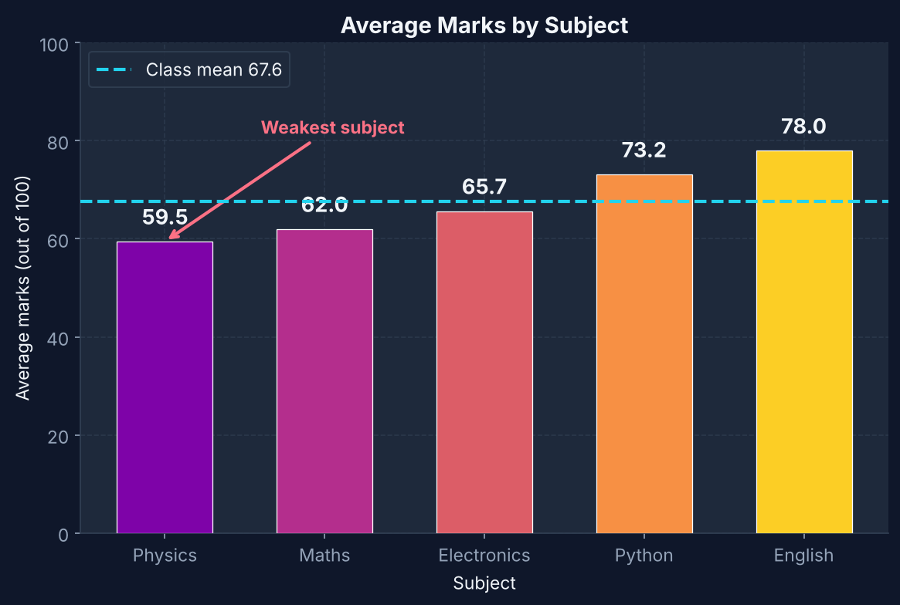
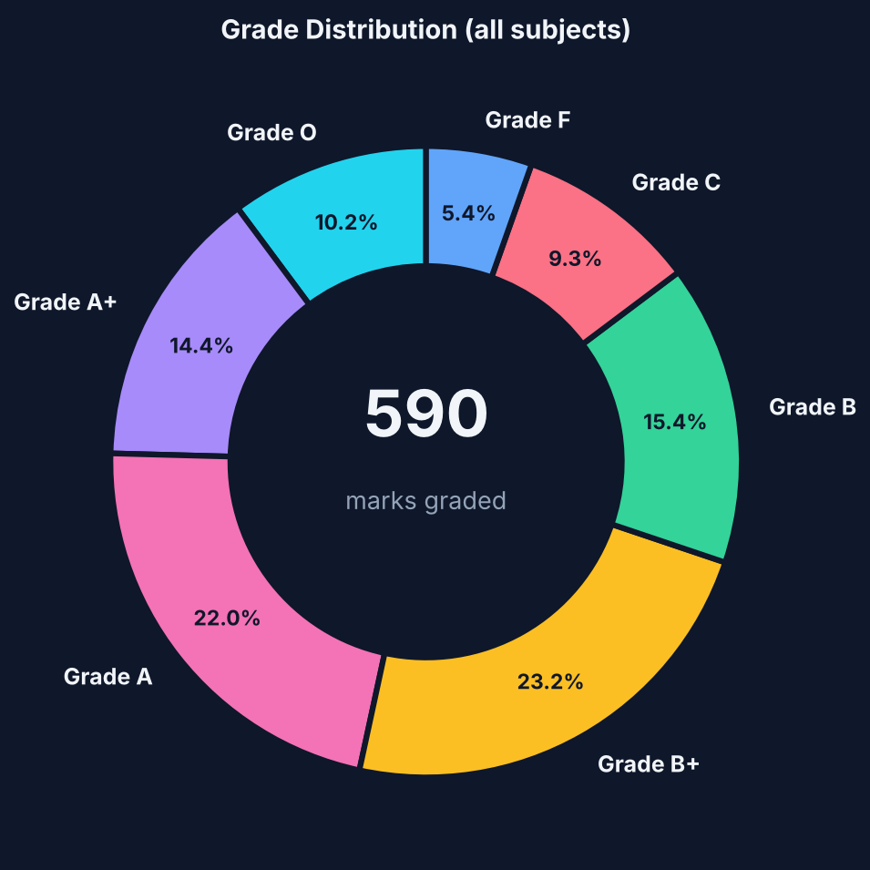
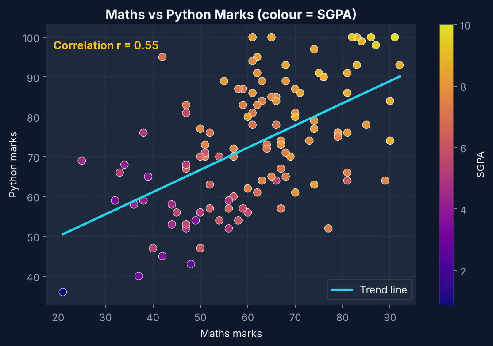
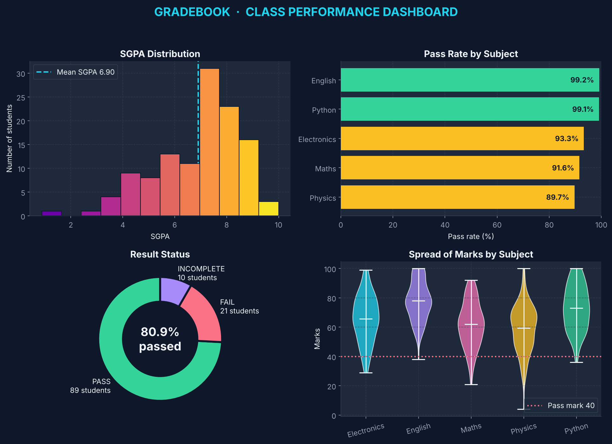

# GradeBook – Student Result Analyzer

**Group 01 · Domain: Education** · Python Programming Group Project · B.Tech CSE (Data Science), Semester III

Teachers spend hours computing totals, grades and class statistics by hand at the end of every semester. **GradeBook** is a menu-driven Python application that stores marks for a class, calculates totals, percentages, grades and SGPA automatically, and ranks students. It saves the data to files and uses pandas and matplotlib to show subject-wise averages, toppers, pass percentage and grade distribution, helping faculty spot weak subjects and students who need support.

## Team
| Member | USN | Component |
|---|---|---|
| Amulya | 25BTRDC008 | Menu, input and validation |
| Adithya Sapkal | 25BTRDC043 | Core logic and functions |
| Aditiya Sahrawat | 25BTRDC003 | Data structures |
| Sinchana G | 25BTRDC048 | Files and error handling |
| Shivani M | 25BTRDC046 | Data analysis |
| Swarnava Banerjee | 25BTRDC053 | Visualisation and report |

## How to run
```bash
pip install -r requirements.txt
python main.py
```
Or open **`GradeBook.ipynb`** (38 executed cells) to see the full project step by step: data loading and exploration, cleaning, grade/SGPA logic, pandas analysis, 5 charts, data structures, 7 error-handling tests, file saving and 3 live menu demos. A PDF copy is in **`GradeBook_Notebook.pdf`**.

To import the existing `marks.csv` records into a local SQLite database and regenerate the data-only Excel workbook and charts, run:
```bash
python create_local_database.py
```
This creates `gradebook.sqlite3` and `GradeBook_Data.xlsx` from the CSV using `settings.json`; the workbook has separate **Marks** and **Student Summary** sheets and contains no charts.

The website's live demo also lets you enter multiple students, keep a removable browser-side log, and download that log as `GradeBook_Entered_Records.xlsx`. The log is saved in browser local storage on the same origin.

## Features
- Add students, enter marks (validated 0–100), view results, search by USN or name, delete
- Automatic total, percentage, grade, SGPA, pass/fail and backlogs
- Class ranking by SGPA
- Data saved to `marks.csv` and settings in `settings.json`
- Handles wrong input, missing files, unknown USNs and damaged files without crashing
- pandas analysis: subject averages, pass rate, toppers, subject toppers, missing marks
- 4 labelled matplotlib charts, including a 2×2 subplots dashboard

## Project structure
| File | Component | Owner |
|---|---|---|
| `main.py` | Integrates all components into one menu-driven program | Group |
| `menu_input.py` | Menu, input and validation | Amulya |
| `core_logic.py` | Total, percentage, grades, SGPA, rank | Adithya Sapkal |
| `data_structures.py` | Nested dictionary of students, search, add, delete | Aditiya Sahrawat |
| `file_handler.py` | CSV/JSON save and load, exception handling | Sinchana G |
| `analysis.py` | pandas and NumPy analysis | Shivani M |
| `visualisation.py` | matplotlib charts (incl. 2×2 subplots) | Swarnava Banerjee |
| `generate_data.py` | Creates realistic sample data with `random` | Group |
| `GradeBook.ipynb` | Full notebook walkthrough with outputs | Group |
| `GradeBook_Notebook.pdf` | PDF of the notebook | Group |
| `GradeBook_Presentation.pdf` | PDF of the presentation | Group |
| `marks.csv` | 600 records (120 students × 5 subjects) | |
| `settings.json` | Subjects, credits, pass mark | |
| `GradeBook_Presentation.pptx` | Project presentation | |

## Requirements checklist
| Requirement | Where |
|---|---|
| One integrated, menu-driven program that runs end to end | `main.py` (10 menu options) |
| At least 100 sample records in CSV/JSON | `marks.csv` – 600 records; `settings.json` |
| Each member owns one component in a separate `.py` file | 6 component files above |
| At least 3 labelled matplotlib charts, one with subplots | 4 charts, chart 4 is a 2×2 subplots dashboard |

## Python concepts used
- **Control flow:** if/elif/else, for, while, break, continue
- **Functions:** `*args`, `**kwargs`, lambda, recursion
- **Data structures:** list, tuple, set, dictionary, nested dictionary, list and dict comprehensions
- **Strings and dates:** string methods (`strip`, `upper`, `title`, `isalnum`), `datetime`
- **Files:** `csv`, `json`, `with open()`
- **Exceptions:** `ValueError`, `KeyError`, `FileNotFoundError`, `JSONDecodeError`, `PermissionError`
- **pandas / NumPy:** DataFrame, `groupby`, `mean`, `sum`, `merge`, `fillna`, `dropna`, `sort_values`, `pivot_table`, NumPy arrays

## Grading rules
| Marks | Grade | Point |
|---|---|---|
| 90–100 | O | 10 |
| 80–89 | A+ | 9 |
| 70–79 | A | 8 |
| 60–69 | B+ | 7 |
| 50–59 | B | 6 |
| 40–49 | C | 5 |
| < 40 | F | 0 |

SGPA = Σ(credits × grade point) / Σ credits

## Results and charts
- Physics (59.5) and Maths (62.0) have the lowest averages – the weakest subjects
- 80.9% of students passed all subjects; average SGPA is 6.90
- 10 students have missing marks and are flagged for follow-up





